# Les cartes

Fiche de chaque carte telle qu'elle est implémentée dans le jeu. Généré depuis `src/sim/cards.js`, qui reste la référence.

Les statistiques de base viennent de [RoyaleAPI/cr-api-data](https://github.com/RoyaleAPI/cr-api-data), ramenées au niveau 9 selon la rareté. Les distances sont en cases d'une arène de 18 × 32. Quelques valeurs absentes de ces données sont estimées : bombes du ballon et du squelette géant, dégâts de la foudre, atterrissage et bond du méga chevalier.

Illustrations : `assets/cards/<id>.png`.

## Tours

- **Tour de princesse** : vie 2534, dégâts 90, cadence 0.8 s, portée 7.5.
- **Tour du roi** : vie 4008, dégâts 90, cadence 1 s, portée 7. Dort tant qu'elle n'est pas touchée et qu'aucune tour n'est tombée.

## Troupes

### Squelettes

1 élixir · commune · ×3

Trois squelettes fragiles pour un seul élixir. Parfaits pour distraire.

Vie 68 · dégâts 68 · cadence 1 s · vitesse Rapide · portée 0.5 · cibles : Sol

### Bombardier

2 élixir · commune

Lance des bombes en cloche sur les groupes au sol. Très fragile.

Vie 276 · dégâts 184 · cadence 1.8 s · vitesse Moyenne · portée 4.5 · cibles : Sol · zone 1.5

### Gobelins

2 élixir · commune · ×4

Quatre gobelins très rapides, redoutables au contact.

Vie 167 · dégâts 100 · cadence 1.1 s · vitesse Très rapide · portée 0.5 · cibles : Sol

### Gobelins à lances

2 élixir · commune · ×3

Trois lanceurs très rapides, au sol comme en l’air.

Vie 110 · dégâts 68 · cadence 1.7 s · vitesse Très rapide · portée 5.5 · cibles : Sol et air

### Chevalier

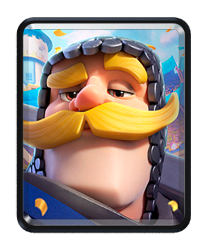

3 élixir · commune

Solide et moustachu : le meilleur rapport vie et prix.

Vie 1463 · dégâts 167 · cadence 1.2 s · vitesse Moyenne · portée 1.2 · cibles : Sol

### Archères

3 élixir · commune · ×2

Deux tireuses à longue portée, sol et air.

Vie 252 · dégâts 89 · cadence 0.9 s · vitesse Moyenne · portée 5 · cibles : Sol et air

### Gargouilles

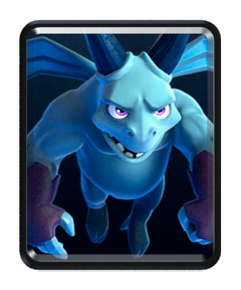

3 élixir · commune · ×3

Trois petites volantes qui crachent au contact.

Vie 191 · dégâts 98 · cadence 1 s · vitesse Rapide · portée 1.6 · cibles : Sol et air · volant

### Armée de squelettes

3 élixir · epique · ×15

Quinze squelettes d’un coup. Un sort de zone les balaie.

Vie 68 · dégâts 68 · cadence 1 s · vitesse Rapide · portée 0.5 · cibles : Sol

### Mousquetaire

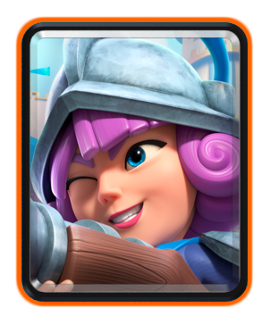

4 élixir · rare

Très longue portée et tir précis, au sol comme en l’air.

Vie 598 · dégâts 181 · cadence 1 s · vitesse Moyenne · portée 6 · cibles : Sol et air

### Valkyrie

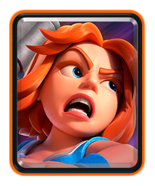

4 élixir · rare

Sa hache balaie tout autour d’elle. Idéale contre les nuées.

Vie 1584 · dégâts 222 · cadence 1.5 s · vitesse Moyenne · portée 1.2 · cibles : Sol · balayage circulaire 2

### Chevaucheur de cochon

4 élixir · rare

Fonce sur les bâtiments et saute la rivière.

Vie 1408 · dégâts 264 · cadence 1.6 s · vitesse Très rapide · portée 0.8 · cibles : Bâtiments · saute la rivière

### Mini P.E.K.K.A

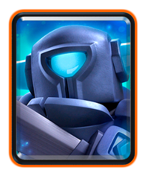

4 élixir · rare

Petit, rapide, et des coups énormes. Crêpes !

Vie 1130 · dégâts 598 · cadence 1.6 s · vitesse Rapide · portée 0.8 · cibles : Sol

### Bébé dragon

4 élixir · epique

Vole et crache un feu de zone.

Vie 958 · dégâts 177 · cadence 1.5 s · vitesse Rapide · portée 3.5 · cibles : Sol et air · volant · zone 1.5

### Barbares

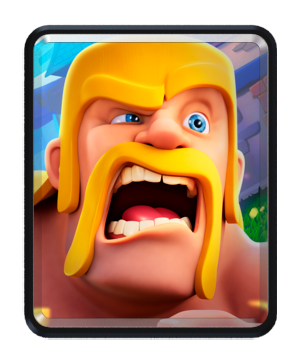

5 élixir · commune · ×5

Cinq costauds à l’épée, une vraie ligne de front.

Vie 555 · dégâts 159 · cadence 1.3 s · vitesse Moyenne · portée 0.7 · cibles : Sol

### Horde de gargouilles

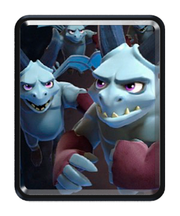

5 élixir · commune · ×6

Six gargouilles : énorme dégâts si personne ne les arrose.

Vie 191 · dégâts 98 · cadence 1 s · vitesse Rapide · portée 1.6 · cibles : Sol et air · volant

### Géant

5 élixir · rare

Très lent, très solide, ne vise que les bâtiments.

Vie 3397 · dégâts 211 · cadence 1.5 s · vitesse Lente · portée 1.2 · cibles : Bâtiments

### Sorcier

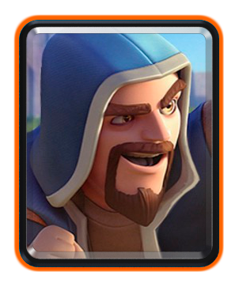

5 élixir · rare

Boules de feu à distance, dégâts de zone sol et air.

Vie 598 · dégâts 234 · cadence 1.4 s · vitesse Moyenne · portée 5.5 · cibles : Sol et air · zone 1.5

### Sorcière

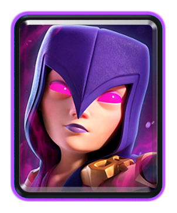

5 élixir · epique

Attaque à distance et invoque quatre squelettes toutes les 7 s.

Vie 697 · dégâts 112 · cadence 1.1 s · vitesse Moyenne · portée 5.5 · cibles : Sol et air · zone 1 · invoque 4 Squelette toutes les 7 s

### Prince

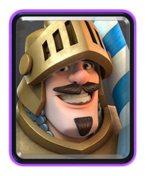

5 élixir · epique

Prend son élan : son premier coup après une charge frappe double.

Vie 1596 · dégâts 326 · cadence 1.4 s · vitesse Moyenne · portée 1.6 · cibles : Sol · saute la rivière · charge après 3 cases : vitesse et dégâts ×2

### Ballon

5 élixir · epique

Vole droit sur les bâtiments et lâche ses bombes. Explose à sa mort.

Vie 1397 · dégâts 532 · cadence 2 s · vitesse Moyenne · portée 0.1 · cibles : Bâtiments · volant · explosion à sa mort 200 (zone 3)

### Squelette géant

6 élixir · epique

À sa mort, il lâche une bombe dévastatrice après 3 s.

Vie 2846 · dégâts 222 · cadence 1.4 s · vitesse Moyenne · portée 0.8 · cibles : Sol · à sa mort : 1 Bombe

### P.E.K.K.A

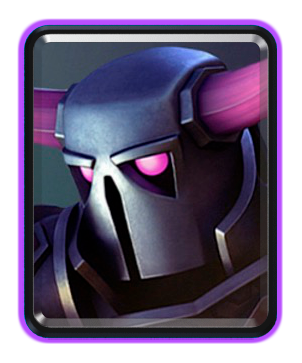

7 élixir · epique

Une armure ambulante, lente, aux dégâts colossaux.

Vie 3126 · dégâts 678 · cadence 1.8 s · vitesse Lente · portée 1.2 · cibles : Sol

### Méga chevalier

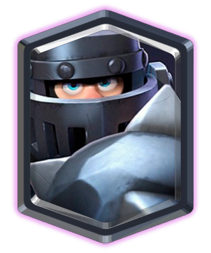

7 élixir · legendaire

Atterrit en écrasant tout, puis bondit d’ennemi en ennemi.

Vie 3300 · dégâts 222 · cadence 1.7 s · vitesse Moyenne · portée 1.2 · cibles : Sol · zone 1.3 · dégâts à l’atterrissage 444 (zone 3) · bondit sur les cibles au sol entre 3.5 et 5 cases, dégâts ×2

### Golem

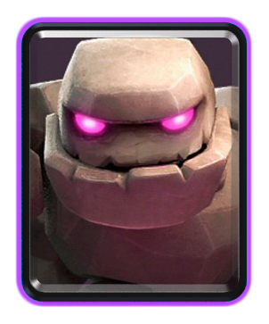

8 élixir · epique

Le plus gros tank. Vise les bâtiments et se scinde en deux golemites.

Vie 4256 · dégâts 259 · cadence 2.5 s · vitesse Lente · portée 0.75 · cibles : Bâtiments · déploiement 3 s · à sa mort : 2 Golemite · explosion à sa mort 186 (zone 2)

## Bâtiments

### Canon

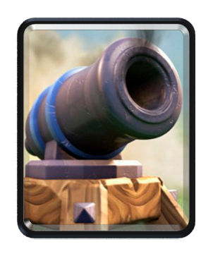

3 élixir · commune

Défense au sol bon marché, attire les chercheurs de bâtiments.

Vie 683 · dégâts 176 · cadence 0.9 s · portée 5.5 · cibles : Sol · durée 30 s

### Pierre tombale

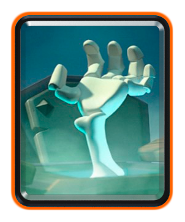

3 élixir · rare

Deux squelettes toutes les 3,5 s, et quatre de plus à sa chute.

Vie 440 · cibles : – · durée 30 s · invoque 2 Squelette toutes les 3.5 s · à sa mort : 4 Squelette

### Tesla

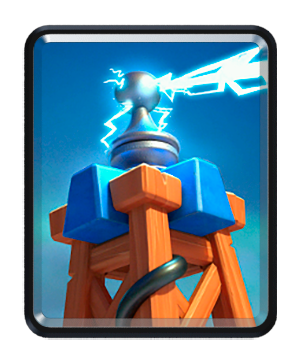

4 élixir · commune

Se cache sous terre tant qu’aucun ennemi n’approche. Sol et air.

Vie 954 · dégâts 191 · cadence 1.1 s · portée 5.5 · cibles : Sol et air · durée 30 s · caché sous terre sans cible

### Mortier

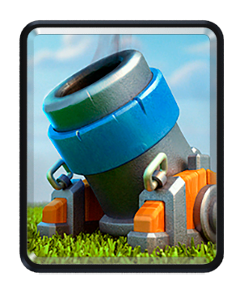

4 élixir · commune

Très longue portée, zone morte de près. Vise le sol.

Vie 1134 · dégâts 220 · cadence 5 s · portée 11.5 · cibles : Sol · durée 30 s · déploiement 3.5 s · zone 2 · zone morte 3.5

### Tour à bombes

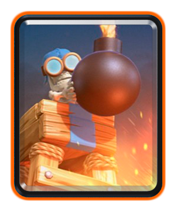

4 élixir · rare

Bombarde le sol, et laisse une dernière bombe en tombant.

Vie 1126 · dégâts 185 · cadence 1.6 s · portée 6 · cibles : Sol · durée 30 s · zone 1.5 · explosion à sa mort 185 (zone 3)

### Tour de l’enfer

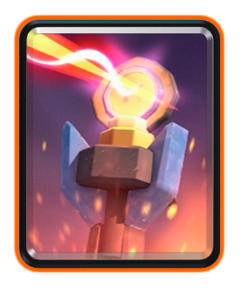

5 élixir · rare

Son rayon chauffe : plus il reste sur une cible, plus il fait mal.

Vie 1452 · dégâts 35 · cadence 0.4 s · portée 6 · cibles : Sol et air · durée 30 s · rayon qui chauffe : 35 → 132 → 704 par tick, palier toutes les 2 s

### Cabane de gobelins

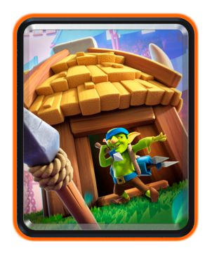

5 élixir · rare

Trois gobelins à lances toutes les 10 s.

Vie 704 · cibles : – · durée 29 s · invoque 3 Gobelin à lances toutes les 10 s · à sa mort : 1 Gobelin à lances

### Extracteur d’élixir

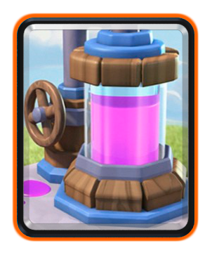

6 élixir · rare

Produit un élixir toutes les 9 s, pendant 65 s.

Vie 889 · cibles : – · durée 65 s · +1 élixir toutes les 9 s

### Arbalète X

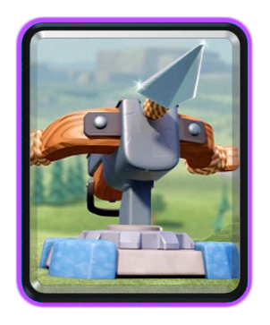

6 élixir · epique

Tir très rapide à très longue portée, depuis votre moitié jusqu’aux tours.

Vie 1330 · dégâts 35 · cadence 0.3 s · portée 11.5 · cibles : Sol · durée 30 s · déploiement 3.5 s

### Cabane de barbares

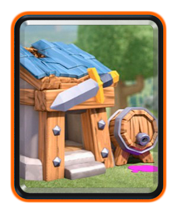

7 élixir · rare

Trois barbares toutes les 14 s.

Vie 968 · cibles : – · durée 30 s · invoque 3 Barbare toutes les 14 s · à sa mort : 1 Barbare

## Sorts

### Miroir

Coût variable · epique

Rejoue votre dernière carte pour un élixir de plus.

Coût : dernière carte + 1 · rejoue la dernière carte posée

### Électrocution

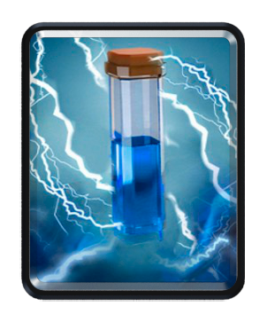

2 élixir · commune

Décharge instantanée, étourdit une demi-seconde.

Rayon 2.5 · dégâts 159 · 30 % sur les tours · étourdit 0.5 s

### Rage

2 élixir · epique

Vos troupes dans la zone bougent et frappent 35 % plus vite.

Rayon 3 · durée 6 s · vitesse ×1.35

### Flèches

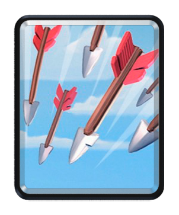

3 élixir · commune

Trois volées sur une large zone. Rase les nuées.

Rayon 4 · dégâts 102 × 3 volées · 30 % sur les tours

### Fût à gobelins

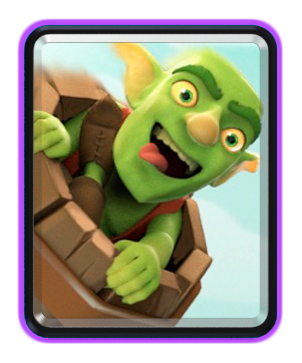

3 élixir · epique

Trois gobelins atterrissent où vous voulez, même chez l’ennemi.

Rayon 1.5 · largue 3 Gobelin

### Boule de feu

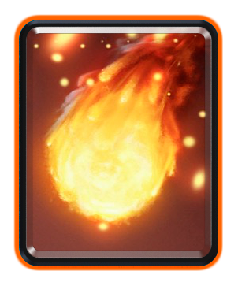

4 élixir · rare

Grosse explosion qui repousse. Dégâts réduits sur les tours.

Rayon 2.5 · dégâts 572 · 30 % sur les tours · repousse

### Gel

4 élixir · epique

Fige tout ce qui est ennemi dans la zone pendant 4 s, tours comprises.

Rayon 3 · dégâts 96 · 30 % sur les tours · durée 4 s

### Roquette

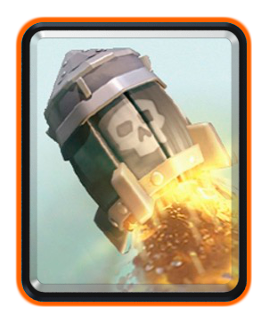

6 élixir · rare

Lente, étroite, et des dégâts monstrueux.

Rayon 2 · dégâts 1232 · 25 % sur les tours · repousse

### Foudre

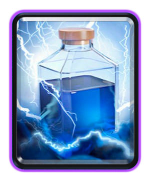

6 élixir · epique

Frappe les trois cibles les plus robustes de la zone.

Rayon 3.5 · dégâts 865 sur 3 cibles · 30 % sur les tours · étourdit 0.5 s

